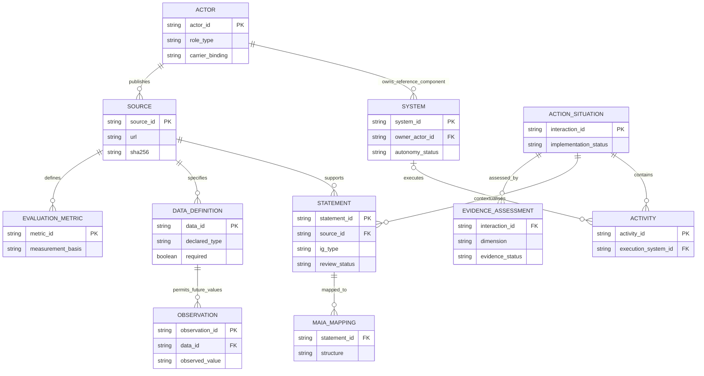

# MAIA evidence dataset ERD

Adapted documentary data model, not a reproduction of the full MAIA simulation metamodel. Actor ownership, statement context and mappings require manual review. Source documents remain linked to statements and data definitions; missing evidence remains visible.

