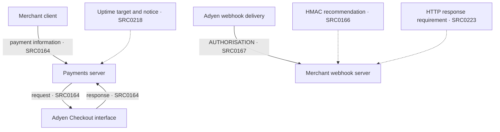

# B01 documented payment boundary

Standard Adyen reference architecture; no carrier configuration asserted. Proposed execution components are not automatically autonomous agents. Dotted arrows are recommendations/requirements addressed to the implementer, not observed runtime behaviour.

Collective: merchant, vendor and shopper roles. Constitutional: security recommendations, HTTP response requirement and contractual notice. Physical: documented fields and execution components (a project extension to MAIA's physical/information resources). Operational: request/response and notification activities. Evaluative: contractual uptime target; observed performance and optimisation weights are unknown. Internal routing from Checkout processing to webhook delivery is deliberately not asserted as a documented system-to-system edge.
